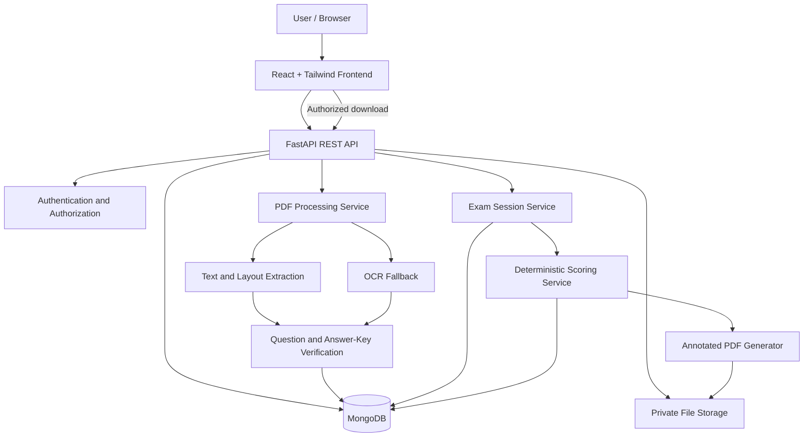
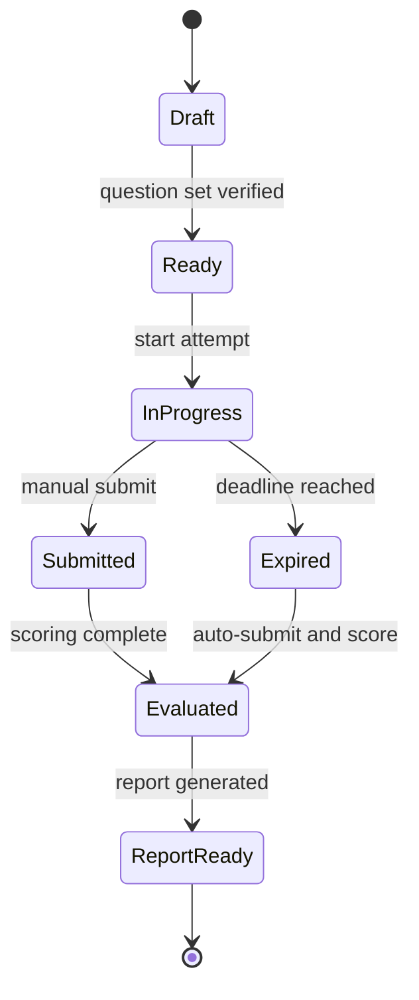

# System Architecture

## 1. Purpose

Secure Exam Portal is a single-learner-oriented PDF MCQ practice platform for GATE preparation. A learner uploads a question paper and a separate answer key, verifies extraction, configures a timed attempt, submits responses, reviews performance, and downloads an annotated copy of the original paper.

## 2. Architecture overview

The diagram describes the target architecture. Some components are not yet implemented.

## 3. Technology choices

| Layer | Selected technology | Responsibility |
|---|---|---|
| Web client | React, Tailwind CSS | Dashboard, PDF review, exam UI, results |
| API | FastAPI / Python | Validation, authentication, business logic |
| Database | MongoDB / PyMongo | Users, documents, question sets, exams, attempts |
| Auth | JWT, bcrypt password hashing | Identity and protected endpoints |
| PDF parsing | PyMuPDF | Text, page metadata, layout and annotation |
| OCR | Tesseract (planned fallback) | Scanned/image-only pages |
| Deployment | Vercel + Render (target) | Frontend and backend hosting |

The currently committed backend uses FastAPI, PyMongo, python-jose and Passlib. PyMuPDF and OCR are planned dependencies, not yet part of the current requirements file.

## 4. Component boundaries

### Frontend
- Authentication and user session.
- Document upload and processing status.
- Question/answer-key verification editor.
- Exam setup and live exam workspace.
- Result breakdown and report download.

The frontend must never be trusted for scoring, timer enforcement, ownership checks, or answer-key secrecy.

### API layer
- Validate request payloads and uploaded files.
- Authenticate the caller.
- Enforce ownership and state transitions.
- Coordinate services and persistence.
- Return stable response schemas and meaningful HTTP errors.

### Document processing
- Validate PDF signatures and limits.
- Extract text and page references.
- Apply OCR only when text extraction is insufficient.
- Parse question numbers, stems, options, and answer-key entries.
- Preserve extraction confidence and source page references.
- Mark uncertain or ambiguous results for manual review.

### Exam service
- Create immutable exam configuration snapshots.
- Start and persist attempts.
- Save answers and mark-for-review state.
- Enforce server-side deadlines.
- Submit idempotently and invoke scoring.

### Scoring service
- Accept a verified answer-key mapping and submitted responses.
- Calculate question-level outcomes and aggregate metrics.
- Never call an LLM to decide correctness.

### Report service
- Open the original question PDF.
- Locate option regions where mapping is reliable.
- Annotate a copy without modifying the source.
- Add a legend and attempt summary.
- Record report storage metadata.

## 5. Main data flows

### 5.1 Upload and verification
1. Client uploads question PDF and answer-key PDF as separate documents.
2. API validates ownership, file type, signature, size, and page count.
3. Files are stored privately using generated storage keys.
4. Processing extracts candidate question and answer-key records.
5. The learner reviews uncertain extraction and corrects mapping.
6. The question set becomes verified only when every included question has a valid, verified answer mapping.

### 5.2 Exam attempt
1. Learner selects a verified question set and configures an exam.
2. API validates question membership and stores the exam settings.
3. API creates an attempt with server-side start and deadline timestamps.
4. Client requests questions without answer-key fields in Real Exam Mode.
5. Responses are saved incrementally.
6. Submission or deadline expiry closes the attempt.
7. Server evaluates responses using the frozen answer-key and scoring snapshots.

### 5.3 Annotated report
1. Report service loads the immutable source question PDF.
2. It maps each question and option to its source page/region.
3. Correct options are highlighted green.
4. Incorrect selected options are highlighted red.
5. For unanswered questions, the correct option is highlighted green and the question is marked unanswered.
6. If the coordinate mapping is uncertain, the system adds a review note instead of drawing a misleading highlight.
7. The generated copy is stored and exposed through an authenticated download endpoint.

## 6. Exam state machine

An attempt must not return to InProgress after submission or expiry. Submission should be idempotent.

## 7. Design decisions

- **Answer key is authoritative:** extraction proposes mappings; learner verification approves them.
- **Immutable source PDFs:** generated annotations never overwrite source files.
- **Server-authoritative timer:** client clocks are display aids only.
- **Real Exam secrecy:** answer keys are not serialized into active exam responses.
- **Explicit uncertainty:** extraction confidence and page references support correction.
- **MVP simplicity:** begin with local/private object storage and synchronous or background processing appropriate to deployment limits; add a dedicated queue only when processing volume requires it.

## 8. Scalability path

For a later production scale:
- Move PDF/OCR processing to a worker queue.
- Store PDFs in private object storage (for example, an S3-compatible service).
- Add job status and retry handling.
- Add rate limiting and upload quotas.
- Add caching for read-only exam metadata, never for secret answer-key responses.
- Add structured logs, metrics, and error tracking.
