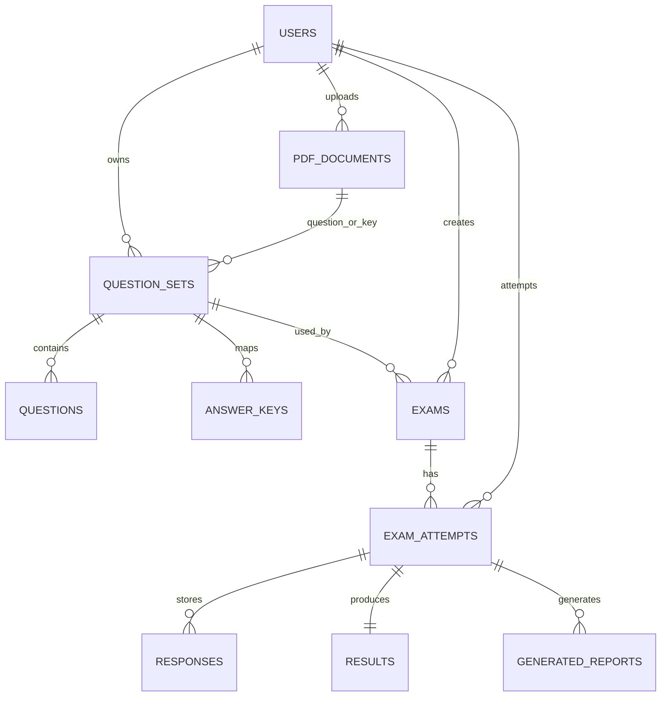

# Data Model

## 1. Conventions

- MongoDB ObjectIds are used for persisted document identifiers.
- All timestamps are UTC ISO dates.
- Every user-owned record stores an `owner_id` or is reachable only through an owner-scoped parent.
- Never store raw passwords, access tokens, or public file URLs.
- Store file metadata and private storage keys in MongoDB; store PDF bytes in private file/object storage.
- The schema below is the target model. Not all collections are implemented yet.

## 2. Collections

### users
| Field | Type | Notes |
|---|---|---|
| _id | ObjectId | Primary key |
| name | string | Display name |
| email | string | Normalized, unique |
| password_hash | string | bcrypt hash |
| role | string | MVP learner role; privileged roles must not be self-assigned |
| created_at | date | UTC |
| updated_at | date | UTC |

Indexes: unique `email`.

### pdf_documents
| Field | Type | Notes |
|---|---|---|
| _id | ObjectId | Primary key |
| owner_id | ObjectId | Owner |
| kind | enum | `question_paper` or `answer_key` |
| original_filename | string | Sanitized display filename |
| storage_key | string | Private random key, not a public URL |
| mime_type | string | Must be application/pdf after validation |
| size_bytes | integer | Enforced against configured limit |
| page_count | integer | Validated after parsing |
| processing_status | enum | uploaded, processing, processed, failed |
| created_at | date | UTC |

Indexes: `{ owner_id: 1, created_at: -1 }`.

### question_sets
| Field | Type | Notes |
|---|---|---|
| _id | ObjectId | Primary key |
| owner_id | ObjectId | Owner |
| title | string | Learner-defined |
| question_pdf_id | ObjectId | Question document |
| answer_pdf_id | ObjectId | Separate answer-key document |
| status | enum | draft, processing, needs_review, verified, failed |
| question_count | integer | Parsed count |
| verified_at | date/null | Set only after verification |
| created_at | date | UTC |

Indexes: `{ owner_id: 1, created_at: -1 }`.

### questions
| Field | Type | Notes |
|---|---|---|
| _id | ObjectId | Primary key |
| question_set_id | ObjectId | Parent set |
| question_number | integer | Stable number within set |
| stem | string | Extracted question body |
| options | array | `[{ label, text, source_region? }]` |
| source_page | integer | 1-based PDF page |
| source_region | object/null | Bounding box for annotation |
| extraction_confidence | number/null | 0..1 |
| review_status | enum | needs_review, verified |

Unique index: `{ question_set_id: 1, question_number: 1 }`.

### answer_keys
| Field | Type | Notes |
|---|---|---|
| _id | ObjectId | Primary key |
| question_set_id | ObjectId | Parent set |
| question_number | integer | Matching question |
| correct_option | string | Option label for initial single-correct MCQ MVP |
| source_page | integer/null | Answer-key page |
| verified | boolean | Must be true before exam |
| verified_by | ObjectId/null | User who verified |
| verified_at | date/null | UTC |

Unique index: `{ question_set_id: 1, question_number: 1 }`.

### exams
| Field | Type | Notes |
|---|---|---|
| _id | ObjectId | Primary key |
| owner_id | ObjectId | Owner |
| question_set_id | ObjectId | Must be verified |
| title | string | Exam title |
| duration_seconds | integer | Bounded duration |
| mode | enum | practice, real |
| marks_correct | number | Non-negative |
| marks_incorrect | number | Non-positive |
| question_numbers | array[int] | Selected questions |
| created_at | date | UTC |

### exam_attempts
| Field | Type | Notes |
|---|---|---|
| _id | ObjectId | Primary key |
| exam_id | ObjectId | Exam |
| owner_id | ObjectId | Attempt owner |
| status | enum | in_progress, submitted, expired, evaluated |
| started_at | date | Server timestamp |
| deadline_at | date | Server timestamp |
| submitted_at | date/null | Server timestamp |
| scoring_snapshot | object | Immutable marks and answer-key version/snapshot |
| created_at | date | UTC |

Indexes: `{ owner_id: 1, created_at: -1 }`, `{ exam_id: 1, status: 1 }`.

### responses
| Field | Type | Notes |
|---|---|---|
| _id | ObjectId | Primary key |
| attempt_id | ObjectId | Parent attempt |
| question_number | integer | Question identifier |
| selected_option | string/null | Selected option or null |
| marked_for_review | boolean | Navigation state |
| answered_at | date/null | Last save time |

Unique index: `{ attempt_id: 1, question_number: 1 }`.

### results
| Field | Type | Notes |
|---|---|---|
| _id | ObjectId | Primary key |
| attempt_id | ObjectId | Unique attempt |
| correct_count | integer | Correct |
| incorrect_count | integer | Incorrect |
| unanswered_count | integer | Blank |
| attempted_count | integer | Correct + incorrect |
| score | number | Includes negative marking |
| accuracy_percent | number/null | Correct / attempted × 100 |
| question_details | array | Per-question result |

Unique index: `{ attempt_id: 1 }`.

### generated_reports
| Field | Type | Notes |
|---|---|---|
| _id | ObjectId | Primary key |
| attempt_id | ObjectId | Parent attempt |
| owner_id | ObjectId | Owner |
| storage_key | string | Private generated PDF |
| status | enum | queued, generating, ready, failed |
| generated_at | date/null | UTC |

## 3. Relationships

## 4. Data integrity rules

1. Question and answer-key documents in a question set must belong to the same owner.
2. A question set cannot be marked verified while a selected question has a missing or unverified answer key.
3. An exam can reference only questions from its verified question set.
4. An attempt stores an immutable snapshot of the exam scoring configuration.
5. A result is created once per attempt; duplicate submissions return the existing result.
6. Deleting a question set must be blocked or cascaded safely when active attempts depend on it.
7. Store report and source file keys separately; never expose storage keys as unauthenticated URLs.
8. Add MongoDB validators where useful and enforce business constraints in the service layer.
